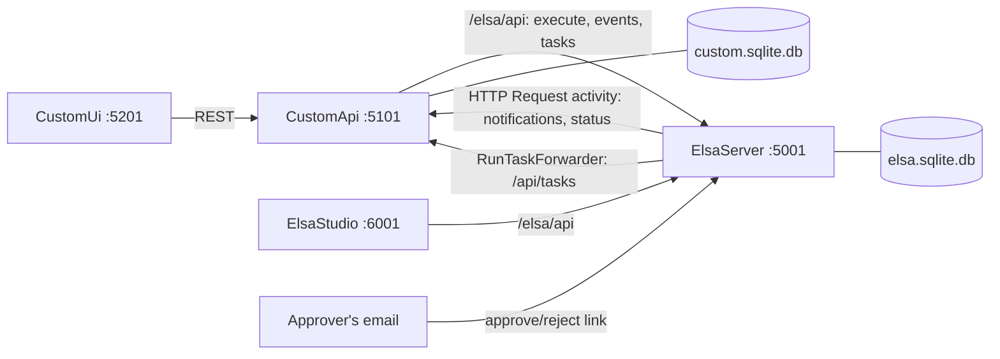

# Phase 2 · Level 2.1 · Separated apps

## Concept overview

Level 2 runs everything in one MVC app: it is the Elsa Server, the business API and the pages at the same time.
Level 2.1 builds the **same order-approval scenario** as four separate apps with two separate databases, the way
a production system is usually split:

| App | Port | Does | Talks to |
|-----|------|------|----------|
| **ElsaServer** | 5001 | Runs workflows. Serves Elsa's REST API (`/elsa/api`) and HTTP workflow endpoints (`/workflows`). No pages, no business API. | `elsa.sqlite.db`; calls CustomApi back over HTTP |
| **ElsaStudio** | 6001 | Designs and inspects workflows (Blazor WebAssembly). | ElsaServer `/elsa/api` |
| **CustomApi** | 5101 | Every business endpoint: orders, approvals, notifications, tasks. Starts and resumes workflows through Elsa's REST API. | `custom.sqlite.db`; ElsaServer `/elsa/api` |
| **CustomUi** | 5201 | Every page except Studio: order form, orders, approvals, notifications. | CustomApi only |

| Database | Owned by | Contains |
|----------|----------|----------|
| `ElsaServer/elsa.sqlite.db` | ElsaServer | Elsa's tables only: definitions, instances, bookmarks, users, logs |
| `CustomApi/custom.sqlite.db` | CustomApi | `Orders`, `Approvals`, `Notifications` — nothing from Elsa |

The two databases share nothing but two plain strings: the **order ID** (also the workflow's correlation ID) and the
**workflow instance ID**.



> **Course note.** Like level 2's approval part, this level uses Phase 4 material (waiting for people) and the
> `Elsa.Email` package. It was added on request.

## What's in this folder

```
level_2_1_separated_apps/
├── level_2_1_separated_apps.sln       Visual Studio solution with the four projects
├── level_2_1_separated_apps.slnLaunch startup profile "Level 2.1 - all apps"
├── ElsaServer/                    Elsa engine + REST API (port 5001)
│   ├── Program.cs                 AddElsa(...) with an explicit ConnectionStrings:Elsa
│   └── Handlers/RunTaskForwarder.cs  forwards "Run Task" requests to CustomApi
├── ElsaStudio/                    Elsa Studio (port 6001), same as level 2
├── CustomApi/                     business REST API (port 5101), no Elsa packages
│   ├── Controllers/OrdersController.cs        POST/GET /api/orders, PUT /api/orders/{id}/status
│   ├── Controllers/ApprovalsController.cs     GET /api/approvals, POST /api/approvals/{id}/decision
│   ├── Controllers/NotificationsController.cs GET/POST /api/notifications
│   ├── Controllers/TasksController.cs         POST /api/tasks (from ElsaServer)
│   ├── Services/ElsaClient.cs                 calls Elsa's REST API with a bearer token
│   └── Data/                                  EF Core model for custom.sqlite.db
├── CustomUi/                      MVC pages (port 5201), no Elsa packages, no database
├── workflows/                     L21_* definitions to import into Studio
└── .gitignore
```

## How the apps work together

| Step | Who → whom | Call |
|------|-----------|------|
| Submit an order | CustomUi → CustomApi | `POST /api/orders` `{product, amount, pattern}` |
| Start the workflow | CustomApi → ElsaServer | `POST /elsa/api/workflow-definitions/{definitionId}/execute` `{correlationId: orderId, input: {Order: {...}}}` |
| Ask for an approval | workflow → CustomApi | HTTP Request activity: `POST /api/notifications` with `pattern` (+ `stage`) → CustomApi stores a **pending approval** |
| Ask for a Run Task | ElsaServer → CustomApi | `RunTaskForwarder`: `POST /api/tasks` `{taskId, taskName, payload}` → pending approval |
| Decide | CustomUi → CustomApi | `POST /api/approvals/{id}/decision` `{approved, reviewer}` |
| Resume: Event | CustomApi → ElsaServer | `POST /elsa/api/events/OrderReviewed/trigger` `{correlationId, input: {Approved, Reviewer}, workflowExecutionMode: "Synchronous"}` |
| Resume: multi-stage | CustomApi → ElsaServer | same, event `L21.ManagerReviewed` / `L21.FinanceReviewed` |
| Resume: Run Task | CustomApi → ElsaServer | `POST /elsa/api/tasks/{taskId}/complete` `{result: {Approved, Reviewer}}` |
| Resume: email link | CustomApi → ElsaServer, or the approver's browser | `GET /workflows/l21/approvals/decision?correlationId=…&decision=approve` |
| Report the result | workflow → CustomApi | HTTP Request activity "ReportStatus": `PUT /api/orders/{id}/status` `{status}` |

### Who placed the order (multi-stage only)

The order form has a **Placed by** dropdown, *Customer* or *Company employee*, shown only when the Multi-stage pattern is selected (other patterns always record *Customer*). The rule lives in CustomApi
(`ApprovalRules.RequiresManagerApproval` in `Data/Entities.cs`), not in the workflow:

| Placed by | Approvals |
|-----------|-----------|
| Customer | manager, then finance |
| Company employee | finance only; the manager is never asked or notified |

CustomApi passes the result to the workflow as `Order.RequireManagerApproval`. The State Machine starts in a
**Routing** state with two automatic (conditional) transitions: to `ManagerReview` when it is `true`, straight to
`FinanceReview` when it is `false`. If the flag is missing, the workflow asks the manager, to be safe.

Two Elsa API details that are easy to get wrong:

- **The event trigger reads the payload from `input`.** A `payload` field is silently ignored and the Event activity
  receives an empty object.
- **Property names are case-sensitive in the workflow's JavaScript.** `HttpClient` sends camelCase by default
  (`orderId`), but the workflows read `getInput("Order").OrderId` and `variables.Review.Approved`. `ElsaClient`
  therefore serializes with the names exactly as written.

## Setup

The real `appsettings.json` files already exist with a random signing key and admin password, and are gitignored.
On a fresh clone, copy each `appsettings.example.json` to `appsettings.json` and fill in:

- `ElsaServer/appsettings.json`: `Identity:Tokens:SigningKey` (32+ random characters) and `Identity:Bootstrap:Password`.
- `CustomApi/appsettings.json`: `ElsaServer:Password`, the **same** password, because CustomApi signs in to Elsa as that user.
- `CustomUi/appsettings.json` has no secrets.

Start a local test SMTP server on port 2525 (for example smtp4dev or Papercut). Without one, the approval workflows fault at
the Send Email step.

## Run

Start the four apps. Order matters only for the first two: ElsaServer must be up before CustomApi starts a workflow.

```bash
dotnet run --project ElsaServer   # https://localhost:5001
dotnet run --project CustomApi    # https://localhost:5101
dotnet run --project CustomUi     # https://localhost:5201
dotnet run --project ElsaStudio   # https://localhost:6001
```

In Visual Studio: open **`level_2_1_separated_apps.sln`** (this folder's own solution) and pick the startup profile
**"Level 2.1 - all apps"** from the start button's dropdown (saved in `level_2_1_separated_apps.slnLaunch`); it starts
all four apps. The projects are also in the course-wide `elsa-learning-dotnet.sln`. Level 2 also uses ports 5001 and
6001, so stop level 2 before running level 2.1.

Then, once: open Studio, sign in as `admin`, and **import and publish all eight files** in `workflows/`. Import the
helpers first (`L21_SendNotification`, `L21_OrderAudit`, `L21_OrderDecidedListener`), then the five order workflows.

Open **https://localhost:5201** and submit orders.

## Try it with curl (or Postman)

CustomApi's endpoints are plain JSON and need no token or antiforgery field (DEV ONLY, see Security).

```bash
# Create an order (pattern: Rule | Event | EmailLink | RunTask | MultiStage)
curl -k -X POST https://localhost:5101/api/orders -H "Content-Type: application/json" \
  -d '{"product":"Server rack","amount":5000,"pattern":"Event"}'

# List pending approvals (note each one's "id")
curl -k https://localhost:5101/api/approvals

# Approve (or "approved": false to reject). A second call returns 409 Conflict.
curl -k -X POST https://localhost:5101/api/approvals/<APPROVAL_ID>/decision -H "Content-Type: application/json" \
  -d '{"approved":true,"reviewer":"manager"}'

# Orders and notifications
curl -k https://localhost:5101/api/orders
curl -k https://localhost:5101/api/notifications
```

## Verification

Tested end to end on Elsa 3.9.0 (12 November 2026), with the four apps on separate ports and a local SMTP sink:

| Check | Result |
|-------|--------|
| Rule: 250 / 5000 | `approved` / `needs_review`, returned directly by `POST /api/orders` |
| Event: 5000 → approve through CustomApi | order `approved`; Audit and Listener notifications arrive |
| Event: 500 | auto-approved, no approval created |
| Email link: reject through CustomApi | order `rejected` |
| Email link: link clicked directly at the Elsa Server | order `approved`; its pending approval is `closed` by the status callback |
| Run Task: approve and reject | task forwarded, completed through `/elsa/api/tasks/{id}/complete`, order updated |
| Multi-stage: manager approve → finance reject / approve | finance approval appears as soon as the manager decides; order `rejected` / `approved` |
| Multi-stage, placed by a company employee | goes straight to finance (no manager notification); one finance approval finishes it |
| Existing `custom.sqlite.db` without `CreatedBy` | column added at startup; old orders read as `Customer` |
| Same approval decided twice | second call `409 Conflict`; CustomUi shows the message |
| CustomUi pages | order form, Orders, Approvals (only sections with pending items), Notifications (needs action / history) |
| Emails | approval emails delivered with working ElsaServer links |
| `elsa.sqlite.db` / `custom.sqlite.db` | Elsa tables only / `Orders`, `Approvals`, `Notifications` only |

Not checked in a browser: Studio itself (it is the level 2 project, unchanged) and the click-locking script.

## Known issues and limits

- **Run Task completion is asynchronous.** `POST /elsa/api/tasks/{id}/complete` returns before the workflow resumes,
  even with `workflowExecutionMode: "Synchronous"`. The approval is marked decided at once, but the order can show
  `waiting` for about a second; refresh the Orders page.
- **Workflow URLs are hard-coded** in the JSON (`https://localhost:5101/...`, `https://localhost:5201/...`,
  `https://localhost:5001/workflows/...`). Change them in Studio if you change ports.
- **`Elsa.Webhooks` has no 3.9.0 release**, so ElsaServer forwards Run Task requests with its own small handler.
- **CustomApi creates its database with `EnsureCreated`** and adds later columns (`Orders.CreatedBy`) with a small startup check. That is fine for learning; a real app would use EF Core migrations.
- **The status callback can fail silently.** If CustomApi is down when a workflow finishes, the HTTP Request activity takes its
  "unmatched status" path and the order stays `waiting` in `custom.sqlite.db`, although Elsa shows the instance finished.

## Security (DEV ONLY)

- CustomApi has **no authentication**: anyone who can reach port 5101 can create orders and decide approvals, and the
  callback endpoints (`/api/notifications`, `/api/tasks`, `PUT /api/orders/{id}/status`) accept any caller. A real system
  would require a user token for CustomUi and a shared secret or signature for ElsaServer's callbacks.
- CustomApi signs in to Elsa with the admin user. A real system would give it its own Elsa user or API key with only the
  permissions it needs.
- ElsaServer's CORS policy allows any origin, for Studio on another port.
- CustomApi follows only approval links that start with `ElsaServer:HttpWorkflowsBaseUrl`, so a stored link cannot make it
  call an arbitrary URL.
