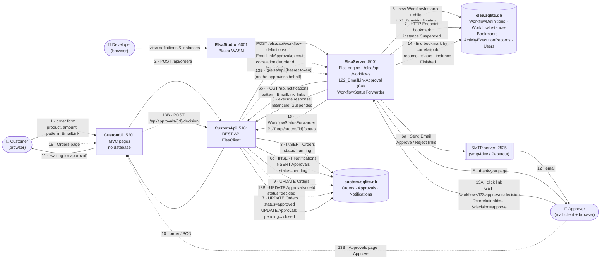
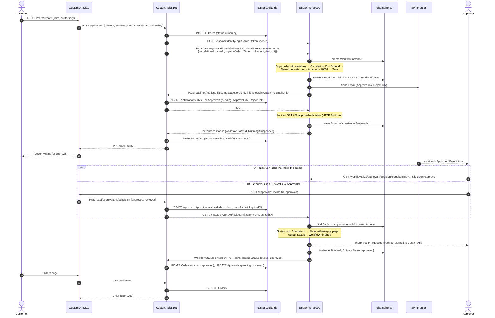

# Level 2.2 · Email-link approval — data flow

How one **"Approve by email link"** order (`L22_EmailLinkApproval`, amount over 1000) moves between the four apps,
the two databases and the mail server. Port numbers are the defaults from each app's `launchSettings.json` /
`appsettings.json`.

> The diagrams are Mermaid. They render on GitHub and in VS Code's Markdown preview with a Mermaid extension.

## 1. Data flow diagram

Numbers on the arrows match the steps in section 3. Solid arrows happen for every order; dashed ones are the
alternatives and the read-only Studio view.

## 2. Sequence diagram

The same flow in time order, with the activity boxes of `L22_EmailLinkApproval` named.

## 3. Steps and the data they carry

| # | From → To | Call / action | Data |
|---|-----------|---------------|------|
| 1 | Customer → CustomUi | `POST /Orders/Create` | Product, Amount, Pattern = `EmailLink`, Placed by |
| 2 | CustomUi → CustomApi | `POST /api/orders` | `{product, amount, pattern, createdBy}` |
| 3 | CustomApi → custom.sqlite.db | `INSERT Orders` | new order ID (GUID), status `running` |
| 4 | CustomApi → ElsaServer | `POST /elsa/api/workflow-definitions/L22_EmailLinkApproval/execute` (bearer token) | `correlationId` = order ID, `input.Order` = `{OrderId, Product, Amount, CreatedBy, RequireManagerApproval}` |
| 5 | ElsaServer → elsa.sqlite.db | create instance (+ child `L22_SendNotification` instance) | variables OrderId, Product, Amount; correlation ID |
| 6a | ElsaServer → SMTP | Send Email (child workflow) | to `manager@l22.local`; Approve/Reject links `…/workflows/l22/approvals/decision?correlationId=<orderId>&decision=approve\|reject` |
| 6b | ElsaServer → CustomApi | `POST /api/notifications` (child workflow, HTTP Request) | `{title, message, orderId, link, rejectLink, pattern: "EmailLink"}` |
| 6c | CustomApi → custom.sqlite.db | `INSERT Notifications`, `INSERT Approvals` | approval `pending` with the two links |
| 7 | ElsaServer → elsa.sqlite.db | HTTP Endpoint suspends | Bookmark (path + correlation ID); instance `Suspended` |
| 8 | ElsaServer → CustomApi | execute response | instance ID, status/sub-status |
| 9 | CustomApi → custom.sqlite.db | `UPDATE Orders` | status `waiting`, `WorkflowInstanceId` |
| 10–11 | CustomApi → CustomUi → Customer | response / page | order JSON → "waiting for approval" |
| 12 | SMTP → Approver | email delivered | the two links |
| 13A | Approver → ElsaServer | `GET /workflows/l22/approvals/decision?…` (anonymous) | `correlationId`, `decision` |
| 13B | Approver → CustomUi → CustomApi → ElsaServer | `POST /Approvals/Decide` → `POST /api/approvals/{id}/decision` → `GET <stored link>` | approved, reviewer; approval row claimed (`decided`) first |
| 14 | ElsaServer → elsa.sqlite.db | bookmark matched, instance resumed and finished | Query variable, Status variable, Output `Status` |
| 15 | ElsaServer → Approver | Write HTTP Response | thank-you HTML |
| 16 | ElsaServer → CustomApi | `WorkflowStatusForwarder` on WorkflowFinished: `PUT /api/orders/{id}/status` | `{status: "approved" \| "rejected"}` |
| 17 | CustomApi → custom.sqlite.db | `UPDATE Orders`, `UPDATE Approvals` | order status + `DecidedAt`; remaining `pending` approvals → `closed` |
| 18 | Customer → CustomUi → CustomApi | `GET /api/orders` | final status shown |

**Amount 1000 or less:** steps 6–7 and 12–17 don't happen. "Amount > 1000?" takes the False branch
("Status = approved (auto)"), the workflow finishes inside step 4, and CustomApi reads `Status` from the execute
response in step 8 (the forwarder also reports it).

## 4. Who owns which data

| Store | Written by | Holds for this flow |
|-------|------------|---------------------|
| `CustomApi/custom.sqlite.db` | CustomApi only | **Orders** (product, amount, pattern, placed by, status, workflow instance ID) · **Approvals** (pattern, links, pending/decided/closed, reviewer) · **Notifications** (title, message, links) |
| `ElsaServer/elsa.sqlite.db` | ElsaServer only | **WorkflowDefinitions** (L22_* published from C#) · **WorkflowInstances** (variables, output, correlation ID, status) · **Bookmarks** (the waiting HTTP Endpoint) · **ActivityExecutionRecords** / logs (Studio's journal) · **Users** (admin) |
| SMTP server | ElsaServer | the approval email |

The two databases never talk to each other. They share only two plain values: the **order ID** (= the workflow's
correlation ID) and the **workflow instance ID** stored on the order.
